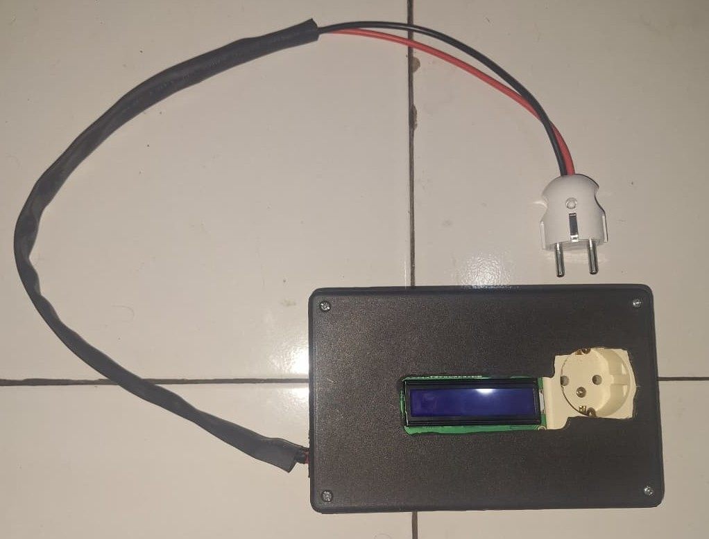
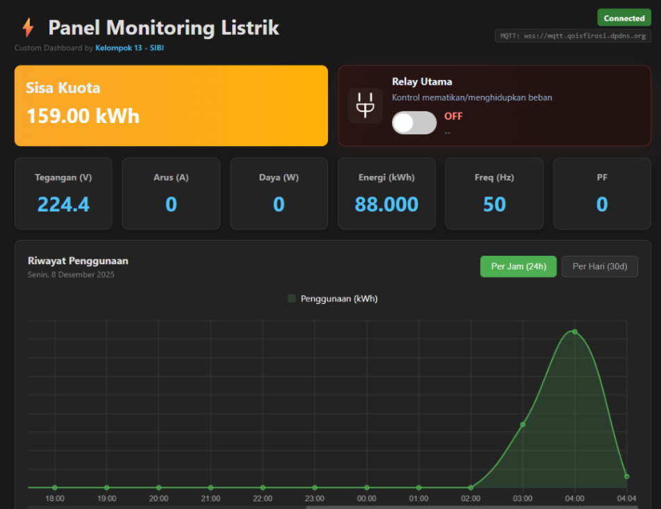

# Smart Power Socket

## Overview

A standard power socket does not track energy use or limit consumption. Smart Power Socket adds electrical measurements, an energy quota, and relay control so users can monitor and limit a connected load from a web dashboard.

The ESP32 reads the PZEM-004T sensor and controls the relay. Node-RED manages the quota balance and stores data in InfluxDB. When the balance runs out, Node-RED sends a command to disconnect power to the load.

Prototype:

## Key Features

- **Electrical monitoring:** displays voltage, current, active power, energy, frequency, and power factor on the dashboard.
- **Quota management:** admins can add to or reset the quota balance. Node-RED sends an OFF command when the balance reaches zero or below.
- **Remote control:** users can send ON/OFF commands and view the relay state reported by the ESP32.
- **Usage history:** hourly charts for the current day and daily charts for the current month, based on InfluxDB records.
- **Remote access:** Cloudflare Tunnel provides public access to local services without port forwarding.
- **Local status:** the LCD shows connection information, power, session energy, and relay state.

User dashboard:

## System Architecture

Components communicate through the Mosquitto broker. Node-RED handles quota calculations and database access, while the dashboard receives data and sends commands through MQTT.

| Connection | Protocol | Purpose |
| --- | --- | --- |
| ESP32 ↔ Mosquitto | MQTT over TCP, port `1883` | Sensor data, relay commands, and relay state |
| Node-RED ↔ Mosquitto | MQTT over TCP, port `1883` | Data processing and message exchange with the dashboard |
| Node-RED ↔ InfluxDB | HTTP, port `8086` | Write sensor data and balances; read data using Flux queries |
| Dashboard ↔ public broker endpoint | MQTT over WSS | Monitoring, control, quota updates, and chart requests |
| Browser → Nginx | HTTP, port `80` on the local service | Load the dashboard's HTML, CSS, and JavaScript |

The dashboard does not access InfluxDB directly. Node-RED receives history requests through MQTT and publishes the query results back through the broker. Mosquitto provides a WebSocket listener on port `9001`; the dashboard is configured to use a public WSS address.

## Hardware & Software Stack

| Hardware | Role |
| --- | --- |
| ESP32 | Reads the sensor, connects to Wi-Fi/MQTT, and controls the relay |
| PZEM-004T and current transformer (CT) | Measure electrical parameters and load energy consumption |
| Relay module | Connects or disconnects power to the load |
| 16×2 I2C LCD | Displays device status locally |
| Hi-Link HLK-10M05 | Provides a 5 V DC supply from an AC source |

| Software | Role |
| --- | --- |
| ESP32 firmware (Arduino/C++) | PZEM readings, data publishing, relay control, and LCD output |
| Eclipse Mosquitto | MQTT broker with TCP and WebSocket listeners |
| Node-RED | Quota logic, power cutoff, history queries, and InfluxDB integration |
| InfluxDB 2 | Time-series storage in the `iot_data` bucket |
| HTML, CSS, JavaScript, MQTT.js, Chart.js | User and admin dashboards and data visualization |
| Nginx | Serves dashboard files |
| Cloudflare Tunnel | Makes local services publicly accessible |
| Docker Compose | Defines server services and their shared network |

## How It Works

```mermaid
flowchart LR
    PZEM[PZEM-004T sensor] -->|UART| ESP[ESP32]
    ESP -->|pzem/data · MQTT TCP| MQTT[Mosquitto broker]
    MQTT -->|Sensor data| NR[Node-RED]
    NR <-->|HTTP :8086| DB[(InfluxDB)]
    MQTT -->|Sensor data, balance, state · WSS| WEB[Web dashboard]
    WEB -->|Control, quota updates, chart requests · WSS| MQTT
    MQTT -->|Quota updates and chart requests| NR
    NR -->|Balance, chart results, OFF command · MQTT TCP| MQTT
    MQTT -->|relay/set| ESP
    ESP -->|relay/state · MQTT TCP| MQTT
    ESP -->|GPIO| RELAY[Relay]
    RELAY --> LOAD[Electrical load]
```

1. **Measurement.** The ESP32 reads the PZEM at a target interval of one second. If the reading succeeds and MQTT is connected, it publishes JSON to `pzem/data`, including voltage, current, power, session energy (`energy_dev`), frequency, and power factor.
2. **Storage and monitoring.** The dashboard receives sensor data from the broker. In parallel, Node-RED stores voltage, current, power, and energy in the `pzem` measurement in InfluxDB.
3. **Quota deduction.** Node-RED reads the latest balance from the `energy_balance` measurement and compares the current session energy with an energy sample from the database. It subtracts the difference from the balance, then stores the updated balance and publishes it to `data/energy_remain`.
4. **Power cutoff.** If the balance is `≤ 0`, Node-RED publishes `OFF` to `relay/set`. The ESP32 switches the relay off and reports `OFF` through `relay/state`. The dashboard also disables the relay control when the quota runs out.
5. **Quota updates.** The admin dashboard publishes `{"add_quota":5}` to `admin/add_quota` to add quota, or `{"set_quota":10}` to `admin/set_quota` to set the remaining balance. Node-RED updates the balance and publishes it to both dashboards. A positive balance enables the relay control again; the user must switch the relay on.
6. **History.** The dashboard publishes `hourly` or `daily` to `graph/request`. Node-RED runs a Flux query against InfluxDB, then publishes the chart title, time labels, and values as JSON to `graph/response`.

Relay state and remaining quota use **retained** MQTT messages, allowing a newly connected dashboard to receive the last values stored by the broker.

In the `full_iot_v5` firmware, session energy is the difference between the sensor reading and a baseline established after boot or a `RESET` command. Resetting session energy does not refill the quota. Balance checks run in Node-RED; the firmware accepts relay commands without checking the balance itself, so quota-based cutoff depends on connectivity and the backend.
